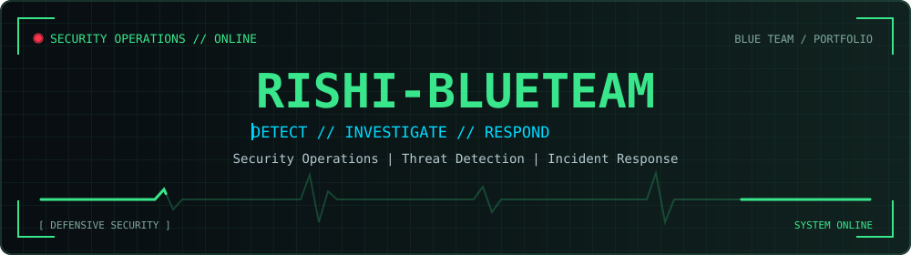
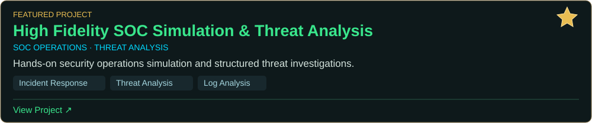
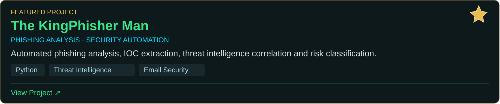
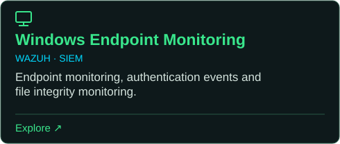
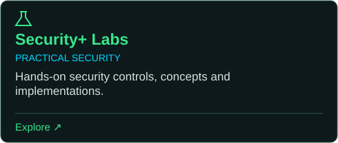
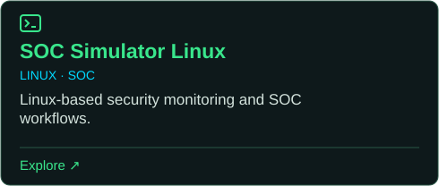
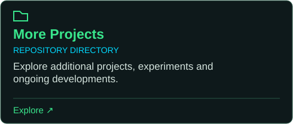
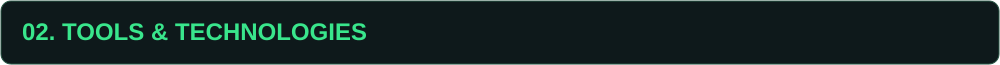
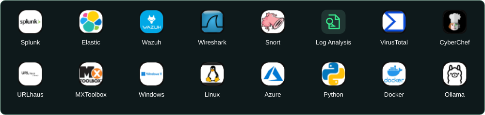

<!-- ================= HEADER ================= -->

  

<!-- ================= Operator ================= -->
<!--

  

-->

<!-- ================= SECURITY PROJECTS ================= -->

  

<!-- FEATURED PROJECTS -->

  

  

<!-- SECURITY LABS: ROW 1 -->

  
  

<!-- SECURITY LABS: ROW 2 -->

  
  

<!-- ================= TOOLS & TECHNOLOGIES ================= -->

  

  

